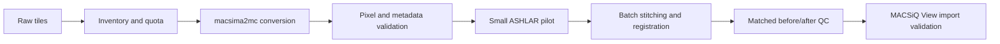

# Xenium–MACSima analysis workflow

A staged, reproducible workflow for MACSima imaging associated with Xenium experiments: input checks, batch image QC, tile stitching, cycle registration and before/after review.

**Initial release: preprocessing and QC foundation.** Xenium transcript processing and cross-modality spatial integration are planned, not implemented. Scripts are research utilities with explicit validation gates. Technical completion does not establish scientific registration quality.

## Follow the steps

| Step | Work | Evidence before continuing |
| --- | --- | --- |
| [01 — Inputs and storage](docs/01-inputs.md) | Inventory ROIs, cycles, channels, exposures and tile coverage | Readable representatives, complete expected inventory, account quota headroom |
| [02 — Batch QC](docs/02-batch-qc.md) | Review image integrity and DAPI alignment | Coverage exclusions, patch metrics and flagged locations |
| [03 — Conversion](docs/03-conversion.md) | macsima2mc, highest exposure, retained DAPI | Every converted plane equals its source; channel map and stage positions verified |
| [04 — ASHLAR](docs/04-ashlar.md) | Pilot, then independent ROI batch in MCMICRO | Successful job, output validation and pilot receipts |
| [05 — Before/after review](docs/05-comparison.md) | Compare matched tissue sites in each cycle | Paired denominator, maps and full-resolution review |
| [06 — MACSiQ View](docs/06-macsiqview.md) | Plan and validate an import adapter | Actual GUI import and human confirmation; still pending |

The example design uses 11 multiplex ROIs and 13 cycles plus an initial reference scan. These are configuration values, not assumptions about every experiment. Survey ROI0 requires a separate inventory and pixel scale; it is excluded from the default multiplex batch.



## Quick start

Use Python 3.12 in separate environments. The QC requirements reproduce the local test versions; the ASHLAR pins reproduce the repaired runtime. Converter dependencies must pass their own resolver and `pip check`.

```bash
python3.12 -m venv .venv
.venv/bin/python -m pip install -r environments/qc.txt
.venv/bin/python -m unittest discover -s tests -v
.venv/bin/python scripts/inventory.py --help
.venv/bin/python scripts/patch_qc.py --help
```

Start with [input checks](docs/01-inputs.md), then work through the numbered pages. Cluster commands are templates: populate `config/cluster.local.env`, inspect the resource limits, review storage, and run a pilot before scaling. Do not point example output directories at existing results.

## What is validated

The source workflow completed a real-data pilot with four selected tiles across the initial scan and early/late cycles, producing an 18-channel registered image. Its full multiplex batch was still in progress when this foundation was prepared. This repository generalizes that workflow; its portable configuration has synthetic/local tests and still needs a fresh pilot at each site. See [validation](docs/validation.md) for precise limits.

The repository contains code and generic examples only. Raw images, tissue metadata, private filesystem paths, account identifiers, patient information and run logs stay outside Git. Local manifests contain paths and must also remain private. No original pixels are modified; only new converted metadata and output images are written.

## Development stages

- Foundation: input inventory, QC metrics/plots, conversion validation and pilot-gated ASHLAR templates.
- Next: review the full batch, extend field-level seam diagnostics and validate the public runner on a fresh pilot.
- Then: complete and validate MACSiQ View export/import.
- Later: define Xenium/MACSima coordinate mapping, segmentation handoff and multimodal analysis with explicit correspondence checks.

See [contributing](CONTRIBUTING.md) for maintenance rules and [references](docs/references.md) for upstream software attribution. ASHLAR and MCMICRO supply the stitching/registration implementation; this repository supplies orchestration and QC.
