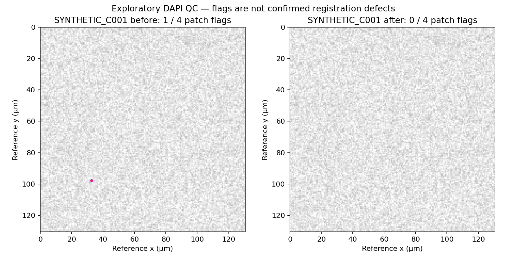

# 02 — Batch image QC

Image QC has separate questions: are expected files present and readable; are tile seams plausible within a cycle; do corresponding tissue locations align across cycles? A single count cannot answer all three.

The first version implements inventory checks and paired DAPI patch screening in `scripts/patch_qc.py`. It requires a JSON list of explicit before/after channel images and verified common canvases. Complete [the mapping checks](05-comparison.md) before using it.

```bash
.venv/bin/python scripts/patch_qc.py \
  --manifest /path/to/paired_qc.local.json \
  --out /path/to/new-qc-output
```

Each entry produces a before/after PNG and a CSV of paired patch metrics; all entries are summarized in `summary.json` and sampling parameters in `method.json`. Add one entry for each ROI/cycle. `channel` is a zero-based plane index in a stitched TIFF's single series, not a marker label.

## Measurement

The default reduces pixels by a 4×4 area mean and samples 96×96 overview patches with stride 96. Each cycle patch is compared with its own processing version's reference patch. Log-intensity high-pass filtering reduces slow illumination variation. We report unshifted normalized cross-correlation (NCC), the phase-correlation displacement estimate and NCC after fitting that displacement for diagnostic confidence. Fitted images are not saved or substituted for the unshifted measurement.

Exploratory flags use unshifted NCC below 0.5, or displacement above 8 input pixels when fitted NCC is at least 0.5 and the shift fits within the fixed central support. Report the corresponding physical scale using the manifest's pixel size. These defaults are screening choices, not validated acceptance limits.

The two versions share the same retained sites and denominator. A patch is excluded from both when support is below 90%, reference texture is inadequate, or before/after references do not match. Zero retained sites is `insufficient_support`, never a pass. Counts are **patches**, not cells or confirmed defective tiles.

Base uint16 planes that can be memory-mapped are reduced in row blocks. Compressed base planes larger than 1 GiB are refused to avoid uncontrolled decoding. Supply an explicitly generated overview with its true pixel size if needed; thresholds then refer to that input image's pixels.

## Interpretation

Bleaching, staining differences, tissue loss and blur can lower NCC. A seam repeated identically in reference and cycle can escape this test. Inspect flagged and unflagged locations at full resolution, including tile edges. Vendor applied shifts and empty-overlap flags may provide context but are not independent measurements of residual registration error.

Dedicated intensity distributions, seam scores, population statistics and automatic correction acceptance are not implemented in this foundation.

## Synthetic example



One quadrant in the synthetic before cycle is displaced by 12 input pixels; the after cycle matches the reference. This verifies the simple displacement-screening behavior only and makes no claim about experimental tissue. Reproduce the figure with:

```bash
.venv/bin/python examples/make_synthetic_qc.py --out /path/to/new-synthetic-demo
```
